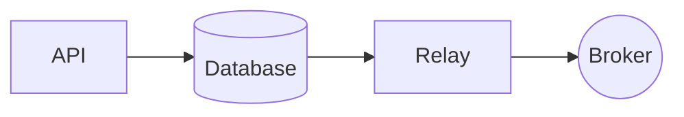

## 0
### body
<!-- section separator -->
:::muted
Goal
:::

A sample document in the legacy directive format: muted section lines, an accordion of steps, a code and preview tab, a figure
with a caption line, a command block. A long path like `examples/service/src/modules/orders/pending-events.relay.ts` is only a warning.

:::muted
Steps
:::

::::::accordion
:::::panel{title="Step 1 - A pending table"}
Each row is an event waiting to be sent.

```typescript
// src/events/pending-event.ts
export type PendingEvent = { id: string; sentAt: Date | null }
```
:::::

:::::panel{title="Step 2 - Write in one transaction"}
```typescript
await db.transaction(async (tx) => {
  await tx.insert(orders).values(order)
  await tx.insert(pending).values(event)
})
```
:::::

:::::panel{title="Step 3 - A status table"}
::::tab
:::code
```tsx
export const Rows = () => <Table rows={rows} />
```
:::
:::preview
```mdx
<Table rows={[{ id: "e1" }]} />
```
:::
::::
:::::

:::::panel{title="Step 4 - Check it"}
```bash
curl -s -X POST localhost:3000/orders
```
:::::
::::::



Figure 1: the API writes the row and the event together; the relay reads and forwards them.

:::muted
Result
:::

**Write the event in the same transaction as the row.** The relay runs on its own, so a consumer drops repeats.
